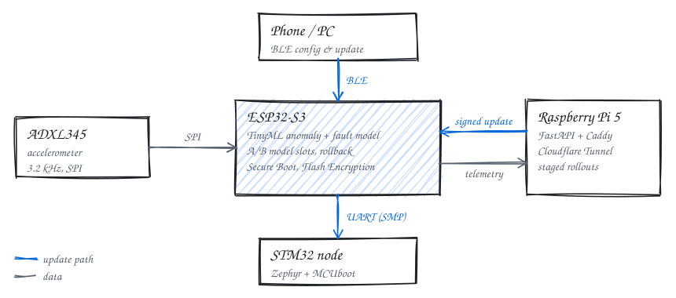

  

  

  
  
  

## 👋 About me

Embedded systems student who enjoys the whole path from a sensor register to a server dashboard.

- 🔧 Firmware for **ESP32-S3** (ESP-IDF) and **STM32** (Zephyr + MCUboot)
- 🔐 Secure firmware updates: signed manifests, delta patches, A/B slots, rollback, Secure Boot
- 🧠 TinyML: int8 models running on the microcontroller with TensorFlow Lite Micro
- 🖥️ Self-hosted Linux servers on Raspberry Pi 5 with Docker, Caddy and Cloudflare Tunnel
- 🌱 Looking for an **internship** in embedded systems / IoT

> 🇻🇳 Xin chào! Mình là Nguyên, sinh viên theo hướng hệ thống nhúng và IoT: viết firmware cho ESP32/STM32,
> cập nhật OTA an toàn và chạy AI ngay trên vi điều khiển. Mình đang tìm cơ hội thực tập.

## 🛠️ Tech stack

  
  
  
  
  
  
  

<picture>
  <source media="(prefers-color-scheme: dark)" srcset="https://skillicons.dev/icons?i=c,cpp,py,bash,linux,docker,raspberrypi,tensorflow,fastapi,sqlite,qt,cmake,git,githubactions&theme=dark"/>
  
</picture>

## 🚀 Featured project

### 🔒 [secure-tinyml-ota](https://github.com/TrongNguyen0/secure-tinyml-ota) &nbsp;private · graduation thesis, in progress

Vibration monitoring with TinyML on ESP32-S3, plus secure over-the-air updates of both the firmware and the AI model,
served from a Raspberry Pi 5 ([pi-server](https://github.com/TrongNguyen0/pi-server)).

<picture>
  <source media="(prefers-color-scheme: dark)" srcset="assets/architecture-dark.svg"/>
  
</picture>

- **On-device AI:** ADXL345 at 3.2 kHz → FFT features → int8 autoencoder + fault classifier, on-device calibration and drift detection
- **Update security:** CBOR/COSE (SUIT-style) signed manifests, anti-rollback, A/B model slots tested against power cuts, Secure Boot v2 + Flash Encryption
- **Delivery:** delta updates at ~2% of full size, BLE OTA, per-device signed requests, staged rollouts that halt themselves on failures
- **STM32 node:** Zephyr + MCUboot, updated through the ESP32-S3 over SMP
- **Testing:** 67k host checks under ASan/UBSan with fuzzing, end-to-end tests against the real server, CI

## 🐍 Contributions

<picture>
  <source media="(prefers-color-scheme: dark)" srcset="https://raw.githubusercontent.com/TrongNguyen0/TrongNguyen0/output/github-snake-dark.svg"/>
  <source media="(prefers-color-scheme: light)" srcset="https://raw.githubusercontent.com/TrongNguyen0/TrongNguyen0/output/github-snake.svg"/>
  
</picture>

  

